# SecureGrade — Hệ thống nhập điểm chống giả mạo đầu vào

**Đồ án cuối kỳ — Bảo mật mạng máy tính và hệ thống**
Hướng 1: Thiết kế hệ thống an toàn

| | |
| --- | --- |
| Giảng viên hướng dẫn | *(điền)* |
| Nhóm | *(điền tên nhóm)* |
| Thành viên | *(điền họ tên — MSSV, mỗi người một dòng)* |
| Ngày nộp | *(điền)* |


> Toàn bộ số liệu trong báo cáo này được đo trên prototype thật, chạy ngày 26/10/2026.
> Môi trường đo: Windows 11, Docker Desktop 29.3.1, Node.js 22 (container) / 24 (host),
> PostgreSQL 16-alpine, ModSecurity 3.0.17 + OWASP CRS 4.30.0.

---

## Mục lục

1. Chương 1. Giới thiệu
2. Chương 2. Cơ sở lý thuyết
3. Chương 3. Phân tích tài sản và rủi ro
4. Chương 4. Thiết kế kiến trúc
5. Chương 5. Hiện thực prototype
6. Chương 6. Kịch bản tấn công và kiểm thử
7. Chương 7. Phân tích trade-off
8. Chương 8. Kết luận
9. Phụ lục

---

## Chương 1. Giới thiệu

### 1.1 Bối cảnh

Điểm số là dữ liệu quyết định học bổng, cảnh báo học vụ và điều kiện tốt nghiệp. Khác với
dữ liệu thông thường, giá trị của bảng điểm nằm ở **tính toàn vẹn**: một con số bị sửa sai
một lần mà không ai phát hiện sẽ đi theo sinh viên suốt khoá học.

Hai quan sát dẫn tới đề tài này:

1. Cổng vào duy nhất để sửa điểm là **tài khoản giảng viên**. Vì vậy kẻ tấn công không cần
   phá hệ thống — chỉ cần trở thành giảng viên trong mắt hệ thống. Các chiến dịch
   phishing và ClickFix (dụ người dùng tự chạy lệnh để cài infostealer) hiện nhắm chính
   xác vào điều đó: lấy mật khẩu, hoặc lấy luôn cookie phiên đang đăng nhập.
2. Hầu hết hệ thống quản lý điểm đều **mặc định tin** những gì đã đi qua cửa đăng nhập:
   tin cookie, tin claim trong token, tin ID mà client gửi lên, và tin dữ liệu đang nằm
   trong cơ sở dữ liệu của mình.

Đề tài trả lời trực tiếp câu hỏi trọng tâm của đề bài: *hệ thống dựa vào đâu để tin, kiểm
chứng hoặc từ chối một thông tin?*

### 1.2 Bài toán

Thiết kế và hiện thực **SecureGrade** — hệ thống nhập và tra cứu điểm cho một bộ môn nhỏ,
với yêu cầu: kể cả khi mật khẩu giảng viên đã bị đánh cắp, cookie phiên đã bị đánh cắp,
hoặc kẻ tấn công đã có quyền ghi trực tiếp vào cơ sở dữ liệu, hệ thống vẫn **chặn được,
hoặc tối thiểu là phát hiện được và phục hồi được**.

### 1.3 Đối tượng sử dụng

| Vai trò | Số lượng (prototype) | Quyền |
| --- | --- | --- |
| STUDENT | 3 (`sv01`–`sv03`) | Xem điểm của **chính mình** |
| LECTURER | 2 (`gv01`, `gv02`) | Xem bảng điểm **lớp mình dạy**, sửa điểm lớp mình dạy |
| ADMIN | 1 (`admin`) | Xem cảnh báo, audit log, kiểm tra toàn vẹn, thu hồi phiên, reset MFA, mở khoá. **Không có quyền sửa điểm** (separation of duties) |

### 1.4 Phạm vi

| Trong phạm vi (đã hiện thực và kiểm thử) | Ngoài phạm vi (chỉ phân tích) |
| --- | --- |
| Phân vùng mạng 3 zone, WAF ModSecurity + OWASP CRS v4 | HTTPS với chứng chỉ thật, HSTS |
| Đăng nhập, MFA TOTP bắt buộc, khoá tài khoản | SSO/OAuth2, WebAuthn/passkey |
| JWT 15 phút + session server-side + thu hồi tức thì | SIEM thật (Wazuh, ELK) |
| RBAC 3 vai trò + kiểm tra ownership | High availability, load balancing |
| Step-up OTP cho mỗi lần sửa điểm | Gửi cảnh báo qua email/SMS |
| Audit log hash-chain, kiểm tra toàn vẹn, rule tương quan | Quản lý secret bằng Vault/HSM |
| Rate limit, security headers, DB least privilege | Mã hoá `mfa_secret` khi lưu (xem 8.2) |
| Backup/restore, thu hồi phiên, reset MFA | Giao diện đẹp, mobile app |

### 1.5 Mục tiêu và kết quả đạt được

| Mục tiêu | Kết quả |
| --- | --- |
| Chứng minh được 5 luồng mạng bị chặn | D1–D5 đều đúng kỳ vọng (bảng 4.3) |
| Bộ test case bao phủ cả luồng bình thường và luồng tấn công | **25/25 PASS** (chương 6) |
| Có ít nhất 2 số liệu đo thật cho phân tích trade-off | False positive PL1 = 0, PL2 = 1/15; RTO restore = **5–6 giây** (2 lần đo) |
| Phát hiện được cả kẻ tấn công có quyền DB | TC22, TC24 phát hiện đúng dòng bị sửa |

---

## Chương 2. Cơ sở lý thuyết

### 2.1 CIA và thứ tự ưu tiên của bài toán này

| Thuộc tính | Vai trò trong SecureGrade |
| --- | --- |
| **Integrity** | Ưu tiên cao nhất. Điểm sai mà không phát hiện được là thiệt hại không thể sửa. |
| **Confidentiality** | Điểm và thông tin cá nhân của sinh viên khác; secret xác thực. |
| **Availability** | Quan trọng theo thời điểm (hạn chót nhập điểm), nhưng chấp nhận gián đoạn ngắn để bảo vệ toàn vẹn — đây chính là lý do hệ thống **chủ động thu hồi phiên** khi phát hiện bất thường. |

### 2.2 Defense-in-Depth

Không lớp phòng thủ nào được coi là không thể vượt qua. SecureGrade xếp 12 lớp kiểm chứng
độc lập (sơ đồ 06): WAF, rate limit, chữ ký JWT, session server-side, fingerprint, MFA,
RBAC, step-up OTP, validation, ownership, parameterized query + quyền DB tối thiểu, audit
hash-chain. Mục 6.4 chứng minh bằng thực nghiệm: bỏ qua hoàn toàn WAF thì payload SQLi
vẫn bị các lớp sau chặn.

### 2.3 Zero Trust ("never trust, always verify")

Nguyên tắc được áp dụng cụ thể: **mọi request đều được kiểm chứng lại từ đầu**, không có
"đã vào trong thì tin". Hai hệ quả thiết kế đáng chú ý:

- `role` **không** lấy từ claim trong JWT mà đọc lại từ bảng `users` ở mỗi request.
- Một JWT có chữ ký hợp lệ nhưng `sid` không tồn tại trong bảng `sessions` bị coi là
  **dấu hiệu lộ `JWT_SECRET`** (`SESSION_UNKNOWN`, CRITICAL), không phải lỗi người dùng.

### 2.4 Least Privilege

- `app_user` (user DB mà app dùng): không có `DELETE` trên bảng nào, không có `UPDATE`
  trên `audit_log`, không có quyền DDL. Kể cả SQL injection thành công cũng không xoá được
  dấu vết.
- Container `app` chạy bằng `USER node`, không phải root.
- Chỉ container `waf` được publish port; `app` và `db` không có đường ra Internet.

### 2.5 MFA / TOTP (RFC 6238)

TOTP sinh mã 6 số từ `HMAC-SHA1(secret, floor(unix_time / 30))`. Secret nằm trên điện
thoại người dùng và trong DB; mã chỉ sống 30 giây. Hệ thống dùng `epochTolerance = 30`
(chấp nhận lệch ±1 bước thời gian) để tránh từ chối oan khi đồng hồ lệch nhẹ, và chặn
**replay** bằng cặp `last_otp` / `last_otp_at` trong 90 giây.

Điểm quan trọng về mặt thiết kế: TOTP là **yếu tố thứ hai độc lập kênh** — mật khẩu đi qua
trình duyệt có thể bị malware đọc, nhưng mã OTP nằm trên thiết bị khác. Vì vậy một chiến
dịch phishing chỉ lấy mật khẩu sẽ **thất bại và để lại dấu vết** (`MFA_FAIL_THRESHOLD`).

### 2.6 JWT (RFC 7519) và những cạm bẫy đã xử lý

| Cạm bẫy | Cách xử lý trong SecureGrade |
| --- | --- |
| `alg: none` | `jwt.verify(..., { algorithms: ['HS256'] })` — cố định thuật toán |
| Sửa payload | Chữ ký HS256 bằng `JWT_SECRET` ≥ 64 ký tự, app **từ chối khởi động** nếu secret ngắn |
| Token không thu hồi được | `sid` trỏ tới một dòng trong `sessions`; thu hồi = `UPDATE revoked_at` → hiệu lực ngay request sau |
| Tin claim để phân quyền | `role` đọc từ DB, claim chỉ dùng để tra session |
| Token dùng lại ở nơi khác | `fingerprint = SHA-256(User-Agent + IP)` lưu lúc đăng nhập |

### 2.7 OWASP Top 10 (2021) — mapping

| Mục OWASP | Rủi ro tương ứng | Kiểm soát |
| --- | --- | --- |
| A01 Broken Access Control | R04 (IDOR) | RBAC + kiểm tra ownership trong cùng transaction |
| A02 Cryptographic Failures | R09, T8 | bcrypt cost 12, secret ngoài Git, hạn chế HTTP được nêu rõ |
| A03 Injection | R05, R06 | WAF CRS, parameterized query, `textContent`, CSP |
| A04 Insecure Design | — | Pipeline 12 lớp, separation of duties (ADMIN không sửa điểm) |
| A05 Security Misconfiguration | R10 | `helmet`, body ≤ 10 KB, chỉ nhận JSON, ẩn `X-Powered-By` |
| A07 Identification & Auth Failures | R01, R02, R07, R12 | MFA, lockout, rate limit, fingerprint, chống replay OTP |
| A09 Logging & Monitoring Failures | R08 | Audit hash-chain append-only + rule tương quan |

### 2.8 WAF và OWASP CRS v4 — mô hình điểm bất thường

CRS v4 không chặn theo từng rule mà **cộng điểm**: mỗi rule khớp cộng một số điểm theo mức
nghiêm trọng; khi tổng điểm vào ≥ 5 (`inbound_anomaly_score_threshold`), rule 949110 chặn
request. Paranoia Level quyết định tập rule được bật: PL1 là rule có độ chính xác cao, PL2
thêm các rule nhạy hơn (bắt được nhiều biến thể hơn nhưng dễ chặn oan). Số liệu đo thực tế
ở mục 7.2.

### 2.9 Hash-chain cho audit log

Mỗi dòng log lưu `prev_hash` (hash của dòng trước) và `hash` của chính nó:

```
hash = SHA256(prev_hash | ts | actor_id | action | target | detail | ip | severity)
```

Sửa hoặc xoá bất kỳ dòng nào sẽ làm `hash` tính lại không khớp, hoặc làm `prev_hash` của
dòng sau không khớp → phát hiện được **vị trí** bị can thiệp. Hai chi tiết hiện thực quan
trọng:

- `detail` lưu kiểu `TEXT`, không phải `JSONB`: JSONB sắp xếp lại khoá, chuỗi đọc ra khác
  chuỗi đã hash → chuỗi hash sẽ bị báo đứt sai.
- Ghi log được tuần tự hoá bằng `pg_advisory_xact_lock(42)` để hai request đồng thời
  không cùng đọc một `prev_hash` (chuỗi bị rẽ nhánh).

Giới hạn đã biết: người có quyền superuser DB có thể **tính lại toàn bộ chuỗi** sau khi
sửa. Giảm thiểu: mỗi ngày admin ghi `lastHash` ra ngoài hệ thống (anchor) và so lại.

---

## Chương 3. Phân tích tài sản và rủi ro

### 3.1 Tài sản

| ID | Tài sản | Thuộc tính ưu tiên | Vì sao quan trọng |
| --- | --- | --- | --- |
| A1 | Bảng điểm | Integrity, Availability | Quyết định học bổng, cảnh báo học vụ, tốt nghiệp |
| A2 | Tài khoản giảng viên, admin | Confidentiality của thông tin xác thực | Là cổng duy nhất để sửa điểm |
| A3 | Thông tin cá nhân và điểm của sinh viên | Confidentiality | Quyền riêng tư của sinh viên |
| A4 | Secret: `JWT_SECRET`, TOTP seed, mật khẩu DB | Confidentiality | Lộ là mất toàn bộ lớp xác thực |
| A5 | Audit log | Integrity | Bằng chứng điều tra, chống chối bỏ |
| A6 | Dịch vụ web | Availability | Mùa nhập điểm có hạn chót |

### 3.2 Tác nhân đe dọa

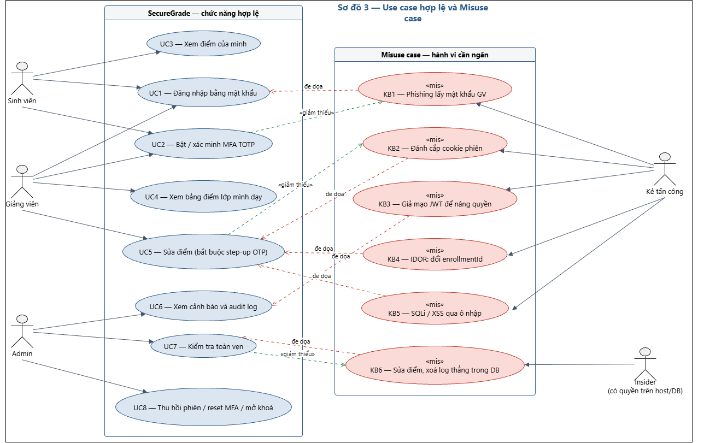

*Hình 3.1 — Use case hợp lệ (trái) đặt cạnh misuse case của kẻ tấn công (phải).*

| Tác nhân | Vị thế | Động cơ | Năng lực giả định |
| --- | --- | --- | --- |
| Sinh viên muốn sửa điểm | Có tài khoản hợp lệ (STUDENT) | Nâng điểm của mình, xem điểm người khác | Biết đọc DevTools, sửa request, đổi ID trong URL |
| Kẻ phishing bên ngoài | Không có tài khoản | Bán dịch vụ "sửa điểm", tống tiền | Dựng trang đăng nhập giả, gửi email/Zalo giả danh phòng đào tạo |
| Malware / infostealer trên máy giảng viên | Chạy với quyền của người dùng trên máy GV | Lấy credential, cookie | Đọc được cookie store của trình duyệt, chụp màn hình |
| Insider có quyền trên host/DB | Quyền `postgres` hoặc quyền trên máy chủ | Sửa điểm trực tiếp, xoá dấu vết | `UPDATE`/`DELETE` bất kỳ bảng nào, kể cả tính lại hash-chain |
| Bot dò mật khẩu | Không có tài khoản | Credential stuffing | Hàng nghìn request/phút, danh sách mật khẩu rò rỉ |

### 3.3 Ma trận rủi ro và kiểm soát

Thang đo định tính: Khả năng và Tác động ∈ {Thấp, TB, Cao}; Rủi ro = Cao nếu cả hai ≥ TB
và có ít nhất một yếu tố Cao; TB nếu còn lại; Thấp nếu cả hai ≤ TB và có một yếu tố Thấp.

| ID | Tài sản | Mối đe dọa (STRIDE) | Khả năng | Tác động | Rủi ro | PREVENT | DETECT | RECOVER | Test case |
| --- | --- | --- | --- | --- | --- | --- | --- | --- | --- |
| R01 | A2 | Phishing/ClickFix lộ mật khẩu (S) | Cao | Cao | **Cao** | MFA TOTP bắt buộc, khoá sau 3 OTP sai | `MFA_FAIL_THRESHOLD` | Đổi mật khẩu, mở khoá | TC09 |
| R02 | A2 | Đánh cắp cookie phiên (S) | TB | Cao | **Cao** | HttpOnly, SameSite=Strict, TTL 15 phút, fingerprint, step-up OTP | `SESSION_CONTEXT_MISMATCH` | Thu hồi phiên, reset MFA | TC14, TC15 |
| R03 | A1 | Giả mạo JWT để nâng quyền (E) | TB | Cao | **Cao** | Chữ ký HS256, cố định `alg`, role đọc từ DB | `JWT_INVALID` | — | TC11, TC12 |
| R04 | A1, A3 | IDOR xem/sửa dữ liệu người khác (T, I) | Cao | Cao | **Cao** | RBAC + ownership | `ACCESS_DENIED_*`, `ALERT_IDOR_BURST` | — | TC16, TC17 |
| R05 | A1 | SQL injection (T) | TB | Cao | **Cao** | WAF CRS, parameterized query, least privilege | Log WAF (rule 942100) | Restore | TC19, mục 6.4 |
| R06 | A3 | Stored XSS qua `reason`, `full_name` (I) | TB | TB | **TB** | WAF, `textContent`, CSP, cookie HttpOnly | Log WAF (941100/941110) | — | TC20 |
| R07 | A2 | Brute force, credential stuffing (S) | Cao | TB | **Cao** | Rate limit, lockout, bcrypt cost 12 | `ACCOUNT_LOCKED`, `RATE_LIMITED` | Mở khoá | TC07, TC08 |
| R08 | A1, A5 | Insider sửa điểm, xoá log trong DB (T, R) | Thấp | Cao | **TB** | `app_user` append-only trên log, DB không mở cổng | Hash-chain + đối chiếu điểm | Khôi phục theo log/backup | TC22, TC23, TC24 |
| R09 | A4 | Lộ secret qua Git hoặc biến môi trường (I) | TB | Cao | **Cao** | `.env` ngoài Git, không dùng `env_file` cho app, dừng app nếu secret ngắn | `SESSION_UNKNOWN` | Rotate secret | — (kiểm tra cấu hình) |
| R10 | A6 | Flood API (D) | TB | TB | **TB** | Rate limit, body ≤ 10 KB, WAF | `RATE_LIMITED` | Khởi động lại | TC08 |
| R11 | A1 | Mất dữ liệu do lỗi hoặc ransomware | Thấp | Cao | **TB** | Phân vùng, app/DB không có egress | — | Backup/restore, RPO 24 giờ | Mục 7.3 |
| R12 | A2 | Nhìn trộm rồi dùng lại OTP (S) | Thấp | TB | **Thấp** | Chặn OTP trùng trong 90 giây | `*_FAIL_REPLAY` | — | TC10 |

Mọi rủi ro trong bảng đều có ít nhất một test case hoặc một phép đo tương ứng, trừ R09 là
rủi ro cấu hình (kiểm tra bằng `git status` và bằng việc app từ chối khởi động với secret
ngắn).

---

## Chương 4. Thiết kế kiến trúc

### 4.1 Phân vùng mạng (sơ đồ 01)

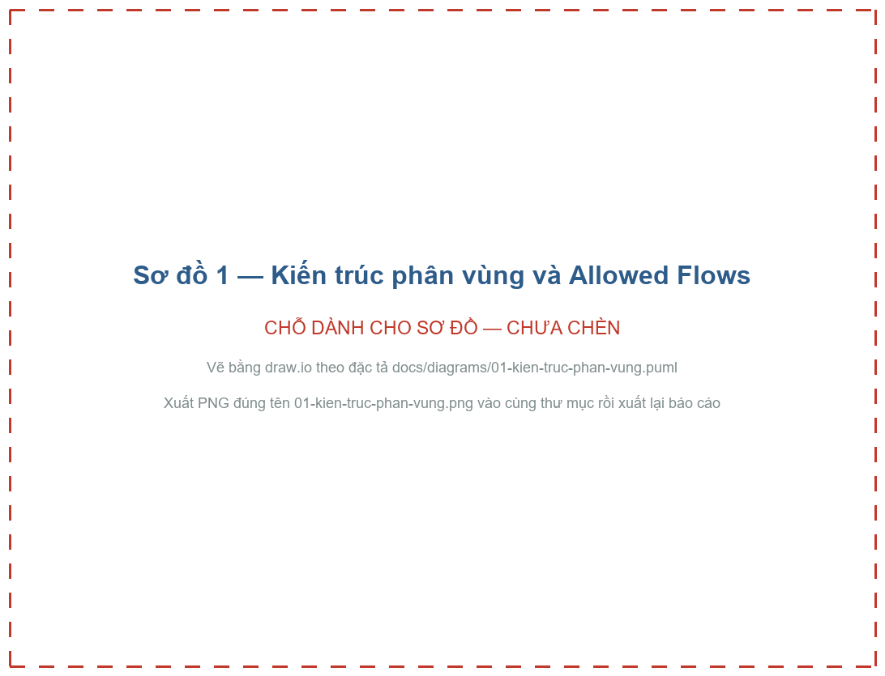

*Hình 4.1 — 3 zone, 4 luồng được phép (F1–F4), 5 luồng bị chặn (D1–D5).*

Hệ thống gồm 3 container nằm trên 3 Docker network tách biệt; **chỉ WAF được publish
port**. Đây là bản thu nhỏ của mô hình Internet → DMZ/WAF → App → Database.

| Zone | Docker network | Container | Publish port | Egress Internet |
| --- | --- | --- | --- | --- |
| Edge / DMZ | `net_public` + `net_app` | `waf` (ModSecurity v3 + OWASP CRS v4, nginx) | 8080 → host | Có (chỉ WAF) |
| App | `net_app` (internal) + `net_data` (internal) | `app` (Node.js/Express) | Không | Không |
| Data | `net_data` (internal) | `db` (PostgreSQL 16) | Không | Không |

`internal: true` trong Docker Compose chặn mọi kết nối ra ngoài của network đó. Container
chỉ nằm trên network internal thì cũng không publish port ra host được — vì vậy WAF cần
thêm `net_public`.

### 4.2 Allowed Flows (mặc định từ chối tất cả)

| ID | Nguồn | Đích | Giao thức/Port | Mục đích | Kiểm soát áp dụng |
| --- | --- | --- | --- | --- | --- |
| F1 | Client (Internet) | `waf:8080` | HTTP (lab), HTTPS (production) | Truy cập web/API | OWASP CRS, rate limit ở app |
| F2 | `waf` | `app:3000` | HTTP nội bộ | Chuyển tiếp request đã lọc | Chỉ qua `net_app` internal |
| F3 | `app` | `db:5432` | PostgreSQL | Truy vấn nghiệp vụ | User `app_user` least privilege |
| F4 | Người vận hành trên host | `db` | `docker compose exec` | Backup, restore, điều tra | Chỉ người có quyền trên host |

### 4.3 Luồng bị chặn — kết quả đo thực tế

| ID | Luồng bị chặn | Cơ chế chặn | Lệnh kiểm tra | Kết quả đo |
| --- | --- | --- | --- | --- |
| D1 | Internet → `app:3000` | `app` không có `ports` | `curl localhost:3000/health` | ✅ connection refused (`curl` trả mã 000) |
| D2 | Internet → `db:5432` | `db` không có `ports` | `docker compose port db 5432` + thử kết nối thật | ✅ không có ánh xạ port; kết nối từ host vào DB `securegrade` bị từ chối (xem 4.3.1) |
| D3 | `waf` → `db` | `waf` không thuộc `net_data` | `docker compose exec waf getent hosts db` | ✅ không phân giải được tên `db` |
| D4 | `app` → Internet | `net_app`, `net_data` là `internal` | `docker compose exec app node -e "fetch('https://example.com')"` | ✅ `D4 OK: egress bi chan` |
| D5 | `db` → ngoài zone Data | chỉ thuộc `net_data` | (suy ra từ cấu hình network) | ✅ |

Ý nghĩa của D4 với bài toán: nếu kẻ tấn công đạt được RCE trong `app`, nó **không thể gửi
dữ liệu ra ngoài** và **không thể tải payload về** — con đường exfiltration và reverse
shell thông dụng nhất bị cắt ở tầng hạ tầng, không phụ thuộc vào code.

#### 4.3.1 Một kết luận sai suýt bị ghi vào báo cáo: cách kiểm chứng D2

Cách kiểm chứng D2 thường được hướng dẫn là chạy `Test-NetConnection localhost -Port 5432`
và chờ kết quả `TcpTestSucceeded: False`. Trên máy dùng để đo, lệnh này trả về **`True`**.

Nguyên nhân: máy có cài sẵn dịch vụ Windows `postgresql-x64-17 — PostgreSQL Server 17`,
dịch vụ này đang lắng nghe `0.0.0.0:5432`. Cổng mở đó **không liên quan gì** đến container
`db` của đồ án. Nếu nhóm chỉ nhìn kết quả `True` rồi kết luận "D2 thất bại, phân vùng
không hoạt động" thì đã kết luận sai.

Phép kiểm chứng đúng gồm ba bước (bằng chứng `03-luong-bi-chan-D2.txt`):

| Bước | Lệnh | Kết quả |
| --- | --- | --- |
| 1. Container có ánh xạ port không? | `docker compose port db 5432` | `invalid IP:0` — không có ánh xạ nào; cột `Ports` của `db` chỉ là `5432/tcp`, không có `0.0.0.0:…->` |
| 2. Ai đang nghe cổng 5432? | `netstat -ano \| findstr ":5432 .*LISTEN"` → PID 8648 | Tiến trình `postgres` của dịch vụ Windows PostgreSQL 17, không phải container |
| 3. Từ host có vào được DB `securegrade` không? | `node tests/check-d2.mjs` | `[28P01] password authentication failed` cho cả `app_user` và `postgres` — server đang nghe không chấp nhận credential của đồ án |

Bài học rút ra, đáng ghi vào báo cáo hơn cả bản thân kết quả D2: **"cổng đóng" và "dịch vụ
của mình không truy cập được từ ngoài" là hai mệnh đề khác nhau.** Một phép kiểm chứng chỉ
nhìn trạng thái cổng có thể cho kết luận sai ở cả hai chiều — báo động giả như trường hợp
này, hoặc tệ hơn, báo an toàn giả khi cổng đóng mà dịch vụ vẫn tiếp cận được qua đường
khác. Kiểm chứng một kiểm soát an ninh phải đi tới tận hành vi cần chặn, không dừng ở một
dấu hiệu gián tiếp.

Chính cái bẫy này lặp lại một lần nữa ở test case TC21, lần này đúng vào lúc tổng duyệt
demo. TC21 kiểm chứng D1 bằng cách gọi `fetch('http://localhost:3000/health')` và chờ
**connection refused**. Lần chạy cuối cùng nó báo **FAIL**: lời gọi trả về `200 OK`. Truy
ra thì tiến trình đang nghe cổng 3000 là một dev server Vite của một dự án khác trên cùng
máy, hoàn toàn không liên quan đến container `app`.

Phép kiểm chứng đã được sửa lại cho hỏi đúng câu hỏi — không hỏi "có ai trả lời ở cổng
3000 không", mà hỏi Docker "`app` có ánh xạ port ra host không":

```js
const ports = (svc) => execSync(`docker compose ps --format "{{.Ports}}" ${svc}`).toString().trim();
check('TC21', !ports('app').includes('->') && !ports('db').includes('->') && ports('waf').includes('->'),
  'chi waf anh xa port ra host, app va db thi khong');
```

Cột `Ports` của `waf` có dạng `0.0.0.0:8080->8080/tcp`, của `app` chỉ là `3000/tcp`. Dấu
`->` chính là ánh xạ ra host. Phép kiểm chứng mới miễn nhiễm với mọi tiến trình khác trên
máy, và khẳng định đúng điều cần khẳng định.

### 4.4 Tech stack

| Thành phần | Công nghệ | Lý do chọn |
| --- | --- | --- |
| WAF / reverse proxy | `owasp/modsecurity-crs:nginx` (CRS 4.30.0) | WAF thật, cấu hình bằng biến môi trường |
| Backend + UI | Node.js 22, Express 5, ESM | Mỗi cơ chế bảo mật là một middleware độc lập, đọc được như một pipeline |
| Xác thực | `bcryptjs`, `jsonwebtoken`, `otplib` v13, `qrcode`, `cookie-parser` | `bcryptjs` thuần JS nên không lỗi build trên Windows |
| Hardening | `helmet`, `express-rate-limit` | Security headers, CSP, chống brute force |
| Database | `postgres:16-alpine`, driver `pg` | Hỗ trợ phân quyền chi tiết theo bảng, có `pg_advisory_xact_lock` |
| Giao diện | HTML + vanilla JS tĩnh (ESM) | CSP của `helmet` chặn inline script; không cần build React |
| Kiểm thử | Script Node (`tests/run-tests.mjs`) | Chạy lại được, xuất bảng PASS/FAIL |

### 4.5 Luồng dữ liệu (sơ đồ 02)

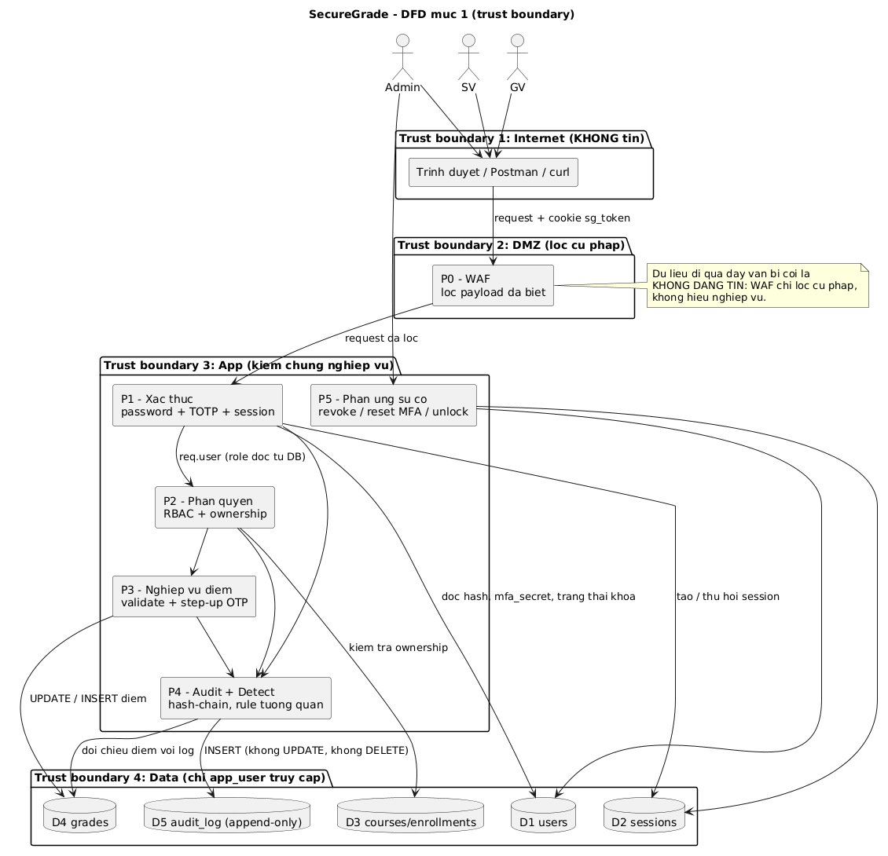

*Hình 4.2 — DFD mức 1 với trust boundary giữa các zone.*

DFD mức 1 chia hệ thống thành 4 trust boundary. Điểm thiết kế đáng chú ý: **dữ liệu đi qua
WAF vẫn bị coi là không đáng tin** — WAF chỉ lọc cú pháp (biết "đây là chuỗi giống SQLi"),
không hiểu nghiệp vụ (không biết "giảng viên này có dạy lớp đó hay không").

### 4.6 Pipeline kiểm chứng cho request sửa điểm (sơ đồ 06)

*Sơ đồ 06 (activity, 409×3031) đặt làm hình cả trang Ở phụ lục D.*

Thứ tự thực thi, mỗi lớp độc lập với lớp trước:

1. **WAF (OWASP CRS)** — chặn payload SQLi/XSS/path traversal đã biết.
2. **Rate limit** — 10 login / 300 API mỗi 15 phút / IP.
3. **JWT** — chữ ký HS256, `alg` cố định, `iss`, `aud`, `exp`.
4. **Session trong DB** — tồn tại, chưa thu hồi, chưa hết hạn, đúng `sub`.
5. **Fingerprint** — cùng User-Agent + IP lúc đăng nhập.
6. **MFA** — đã xác minh trong phiên (`mfa_verified = true`).
7. **RBAC** — role đọc từ DB.
8. **Step-up OTP** — mã mới, chưa từng dùng trong 90 giây.
9. **Validation** — kiểu dữ liệu, miền 0–10, tối đa 2 chữ số thập phân, độ dài `reason`.
10. **Ownership** — giảng viên phải dạy lớp chứa `enrollmentId`.
11. **Parameterized query + quyền DB tối thiểu.**
12. **Audit hash-chain trong cùng transaction** với việc ghi điểm.

Lớp 12 là một quyết định thiết kế quan trọng: audit được `INSERT` **trong cùng
transaction** với `grades`, nên không tồn tại trạng thái "điểm đã đổi mà không có log" —
hai thao tác cùng commit hoặc cùng rollback.

### 4.7 Hệ thống dựa vào đâu để tin một thông tin

Đây là bảng trả lời trực tiếp "Điểm quan trọng của đồ án".

| Thông tin nhận được | Vì sao không tin mặc định | Kiểm chứng bằng | Từ chối khi |
| --- | --- | --- | --- |
| Mật khẩu | Có thể bị phishing, ClickFix, đoán | bcrypt (cost 12) + OTP từ thiết bị riêng | OTP sai, tài khoản khoá |
| JWT trong cookie | Có thể bị sửa payload, đổi `alg`, ký bằng key đoán | Chữ ký + `iss`/`aud`/`exp` + `sid` phải có trong DB | Bất kỳ bước nào sai |
| Claim `role` | Client tự sửa được nếu tin token | **Không dùng**; đọc role từ bảng `users` | — |
| Cookie phiên hợp lệ | Có thể bị infostealer đánh cắp | Fingerprint + step-up OTP cho thao tác nhạy cảm | Khác ngữ cảnh, thiếu OTP |
| `enrollmentId`, `courseId` | Client đổi số để truy cập dữ liệu người khác (IDOR) | Truy vấn ownership trong cùng transaction | Không phải chủ sở hữu |
| `score`, `reason` | Giá trị ngoài miền, payload injection | Validation + parameterized query + WAF + `textContent` ở UI | Sai kiểu, ngoài 0–10, `reason` < 5 ký tự |
| OTP | Có thể bị nhìn trộm rồi dùng lại (replay) | `last_otp` / `last_otp_at` trong 90 giây | Trùng mã vừa dùng |
| IP / `X-Forwarded-For` | Client tự điền header được | `trust proxy = 1`: chỉ tin 1 hop (WAF) | — |
| **Dữ liệu đang nằm trong DB** | Insider hoặc kẻ chiếm DB sửa trực tiếp | Hash-chain audit + đối chiếu điểm với log | Hash đứt hoặc điểm lệch log |

Dòng cuối là điểm khác biệt chính so với một hệ thống thông thường: SecureGrade **không tin
cả cơ sở dữ liệu của chính mình**.

---

## Chương 5. Hiện thực prototype

### 5.1 Cấu trúc thư mục

```text
BaoMatAnNinhMang/
├─ docker-compose.yml        # 3 service, 3 network, 1 volume
├─ .env                      # secret thật (KHÔNG commit)
├─ .env.example              # mẫu
├─ db/init/                  # chạy tự động khi volume DB trống
│  ├─ 01_schema.sql          # 6 bảng
│  ├─ 02_roles.sh            # app_user + GRANT least privilege
│  └─ 03_seed.sql            # 6 user, 2 lớp, 6 enrollment, KHÔNG seed điểm
├─ app/
│  ├─ Dockerfile             # node:22-alpine, USER node
│  ├─ src/
│  │  ├─ server.js           # pipeline middleware
│  │  ├─ config.js           # fail-safe JWT_SECRET
│  │  ├─ db.js               # pool pg
│  │  ├─ middleware/         # auth.js, rbac.js, stepUp.js, limits.js
│  │  ├─ routes/             # auth.js, grades.js, admin.js
│  │  └─ services/           # otp.js, audit.js, integrity.js, detect.js
│  └─ public/                # 5 trang HTML + js/ + css/
├─ tests/
│  ├─ run-tests.mjs          # 25 test case tự động
│  ├─ paranoia-check.mjs     # đo false positive của WAF theo PL
│  └─ attacks/               # forge-jwt.mjs, sqli-direct.mjs
├─ scripts/                  # backup.sh, restore.sh
└─ docs/                     # báo cáo, 8 sơ đồ PlantUML, bằng chứng
```

### 5.2 Phân quyền database (least privilege)

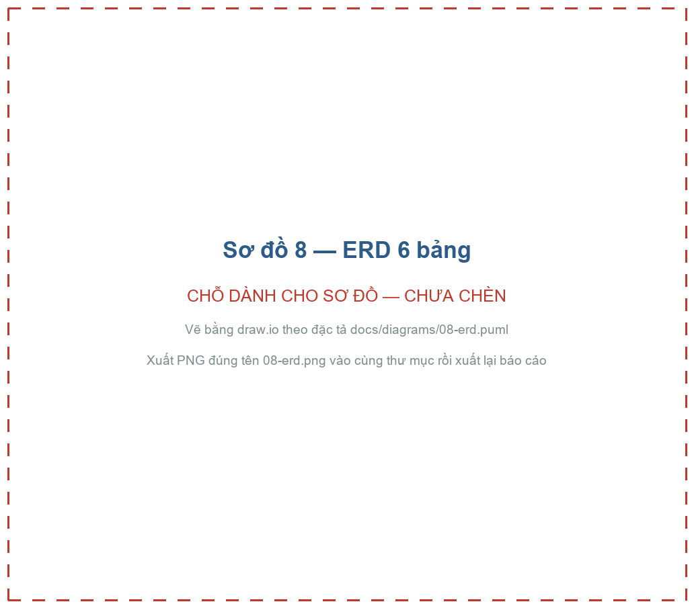

*Hình 5.1 — ERD 6 bảng; `audit_log` là bảng duy nhất chỉ được INSERT.*

| Bảng | SELECT | INSERT | UPDATE | DELETE | Lý do |
| --- | --- | --- | --- | --- | --- |
| `users` | ✅ | ✅ | ✅ | ❌ | Cập nhật MFA, số lần sai, khoá tài khoản |
| `sessions` | ✅ | ✅ | ✅ | ❌ | Thu hồi bằng `revoked_at`, không xoá |
| `courses`, `enrollments` | ✅ | ❌ | ❌ | ❌ | Dữ liệu danh mục do phòng đào tạo quản lý |
| `grades` | ✅ | ✅ | ✅ | ❌ | Không cho xoá điểm qua app |
| `audit_log` | ✅ | ✅ | ❌ | ❌ | **Append-only**: không sửa, không xoá log |

Kiểm chứng (TC23): 4 lệnh `DELETE FROM audit_log`, `UPDATE audit_log`, `DELETE FROM grades`,
`DROP TABLE grades` bằng `app_user` đều bị từ chối, trong khi `SELECT count(*) FROM users`
vẫn chạy được.

### 5.3 Xác thực hai bước (sơ đồ 04)

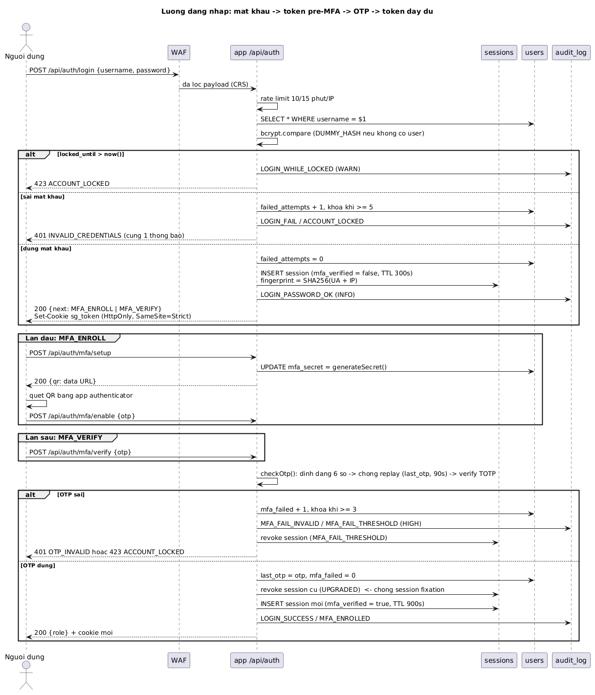

*Hình 5.2 — Luồng đăng nhập hai bước.*

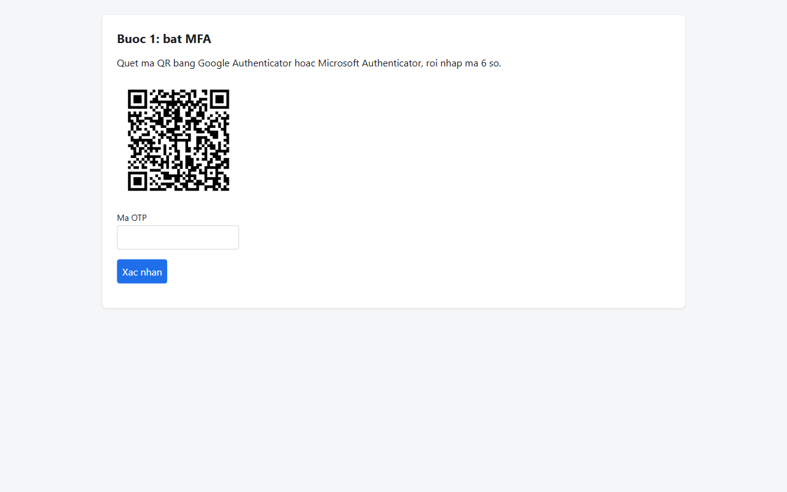

*Hình 5.3 — Màn hình đăng ký MFA lần đầu (TC01).*

Mật khẩu đúng chỉ cho một **token pre-MFA sống 5 phút**; chỉ sau khi OTP đúng mới có token
đầy đủ sống 15 phút. Mọi token đều phải khớp một session còn hiệu lực trong DB.

Trích `middleware/auth.js` — 4 lớp kiểm chứng của một token:

```js
// Lớp 1: chữ ký + thuật toán + iss/aud/exp
claims = jwt.verify(token, config.jwtSecret, {
  algorithms: ['HS256'], issuer: config.issuer, audience: config.audience,
});

// Lớp 2: session phải tồn tại trong DB và đúng chủ
if (!s || String(s.user_id) !== claims.sub) {
  await logEvent({ action: 'SESSION_UNKNOWN', severity: 'CRITICAL' });  // nghi lộ JWT_SECRET
  return deny(res, 401, 'INVALID_SESSION');
}
if (s.revoked_at)  return deny(res, 401, 'SESSION_REVOKED');
if (new Date(s.expires_at) < new Date()) return deny(res, 401, 'SESSION_EXPIRED');

// Lớp 3: đúng ngữ cảnh thiết bị
if (s.fingerprint !== fingerprint(req)) {
  await pool.query(`UPDATE sessions SET revoked_at = now(),
                    revoke_reason = 'CONTEXT_MISMATCH' WHERE id = $1`, [s.id]);
  await logEvent({ action: 'SESSION_CONTEXT_MISMATCH', severity: 'CRITICAL' });
  return deny(res, 401, 'SESSION_CONTEXT_MISMATCH');
}

// Lớp 4: MFA đã xác minh trong phiên
if (!s.mfa_verified && !allowPreMfa) return deny(res, 401, 'MFA_REQUIRED');

// Role lấy từ DB, KHÔNG lấy từ claim trong token
req.user = { id: s.user_id, username: s.username, role: s.role, ... };
```

Hai chi tiết chống tấn công cụ thể:

- **Chống dò username qua thời gian phản hồi**: nếu không tìm thấy user, vẫn gọi
  `bcrypt.compare` với một `DUMMY_HASH` để thời gian phản hồi không khác biệt; và mọi
  trường hợp đều trả về cùng một thông báo `INVALID_CREDENTIALS`.
- **Chống session fixation**: sau khi OTP đúng, session cũ bị thu hồi
  (`revoke_reason = 'UPGRADED'`) và một session mới với ID mới được tạo.

### 5.4 Chống replay OTP

```js
// services/otp.js — trả về 'OK' | 'INVALID' | 'REPLAY'
const recent = user.last_otp_at && Date.now() - new Date(user.last_otp_at).getTime() < 90_000;
if (user.last_otp === token && recent) return 'REPLAY';
const { valid } = await verify({ secret: user.mfa_secret, token, epochTolerance: 30 });
```

### 5.5 Step-up OTP và ownership khi sửa điểm (sơ đồ 05)

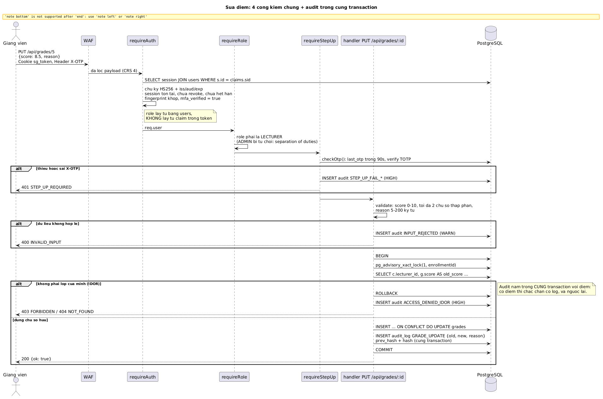

*Hình 5.4 — Sửa điểm: step-up OTP, ownership, audit cùng transaction.*

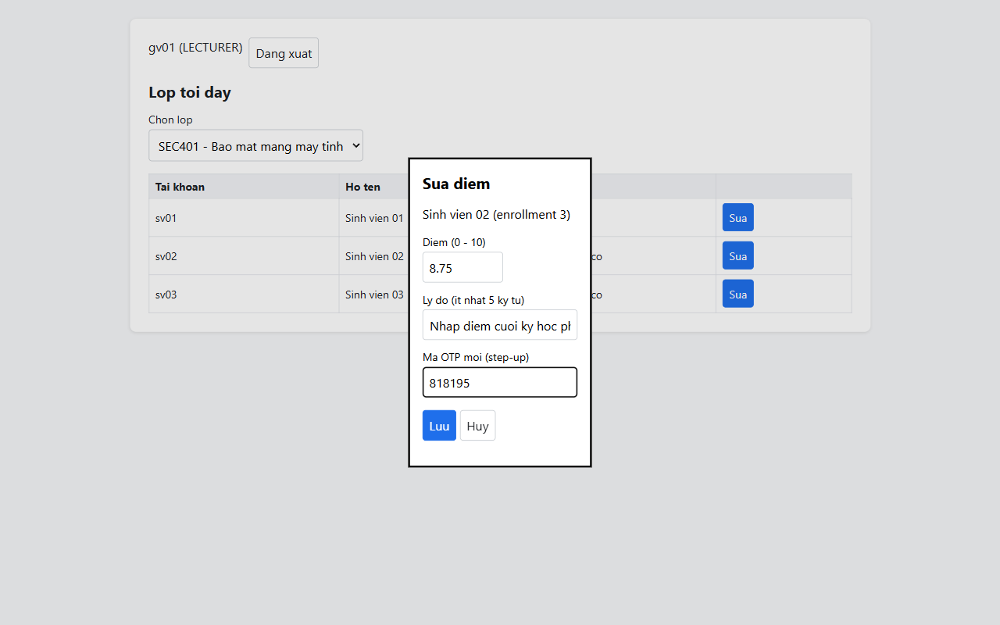

*Hình 5.5 — Giao diện sửa điểm bắt buộc nhập OTP mới.*

Sửa điểm phải qua 4 cổng: đúng vai trò LECTURER, **đúng lớp mình dạy**, dữ liệu hợp lệ, và
**một OTP mới ngay tại thời điểm sửa**. Cổng thứ 4 khiến cookie bị đánh cắp vẫn không đủ để
sửa điểm. ADMIN không có quyền sửa điểm (separation of duties).

```js
await client.query('BEGIN');
await client.query('SELECT pg_advisory_xact_lock(1, $1)', [enrollmentId]);
const { rows: [row] } = await client.query(
  `SELECT c.lecturer_id, g.score AS old_score
     FROM enrollments e JOIN courses c ON c.id = e.course_id
     LEFT JOIN grades g ON g.enrollment_id = e.id
    WHERE e.id = $1`, [enrollmentId]);

if (!row || row.lecturer_id !== req.user.id) {           // KIỂM TRA OWNERSHIP (chống IDOR)
  await client.query('ROLLBACK');
  await logEvent({ action: 'ACCESS_DENIED_IDOR', severity: 'HIGH' });  // log NGOÀI transaction
  return res.status(row ? 403 : 404).json({ error: row ? 'FORBIDDEN' : 'NOT_FOUND' });
}
await client.query(`INSERT INTO grades ... ON CONFLICT (enrollment_id) DO UPDATE ...`);
await logEvent({ client, action: 'GRADE_UPDATE',
                 detail: { old: num(row.old_score), new: score, reason } });  // CÙNG transaction
await client.query('COMMIT');
```

Ghi chú hiện thực: `SELECT ... FOR UPDATE` không dùng được ở đây vì `app_user` chỉ có quyền
`SELECT` trên `enrollments`; `pg_advisory_xact_lock` thay thế mà không cần nới quyền.

### 5.6 Audit log hash-chain

```js
await db.query('SELECT pg_advisory_xact_lock(42)');   // ghi tuần tự => chuỗi không rẽ nhánh
const { rows } = await db.query('SELECT hash FROM audit_log ORDER BY id DESC LIMIT 1');
const e = { prev_hash: rows[0]?.hash ?? GENESIS, ts: new Date().toISOString(), ... };
e.hash = hashOf(e);
await db.query(`INSERT INTO audit_log (...) VALUES ($1, ..., $9)`, [...]);
if (severity === 'HIGH' || severity === 'CRITICAL') console.warn(`[ALERT][${severity}] ...`);
```

### 5.7 Kiểm tra toàn vẹn: hai phép đối chiếu độc lập

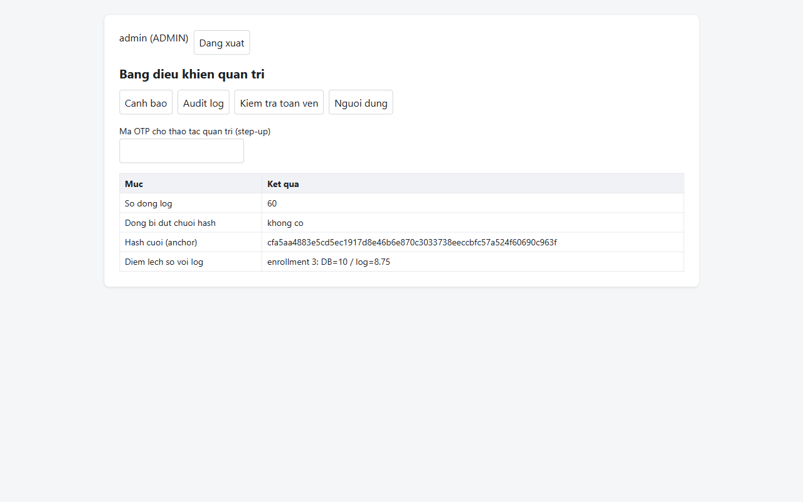

*Hình 5.6 — Insider sửa điểm thẳng trong DB bằng role `postgres`; hệ thống chỉ ra `enrollment 3: DB=10 / log=8.75` (KB6, TC22).*

`GET /api/admin/integrity` chạy hai hàm:

1. `verifyChain()` — đi hết `audit_log` theo `id`, tính lại hash từng dòng, trả về danh
   sách `broken` và `lastHash` (giá trị anchor để lưu ra ngoài hệ thống).
2. `reconcileGrades()` — `FULL JOIN` giữa bảng `grades` và dòng `GRADE_UPDATE` mới nhất của
   từng enrollment. `FULL JOIN` (không phải `LEFT JOIN`) để phát hiện cả ba trường hợp:
   điểm bị **sửa**, điểm bị **xoá**, và điểm bị **chèn thẳng vào DB** mà không có log.

Có vi phạm thì ghi `INTEGRITY_VIOLATION` (CRITICAL) kèm danh sách cụ thể.

### 5.8 Danh mục sự kiện audit

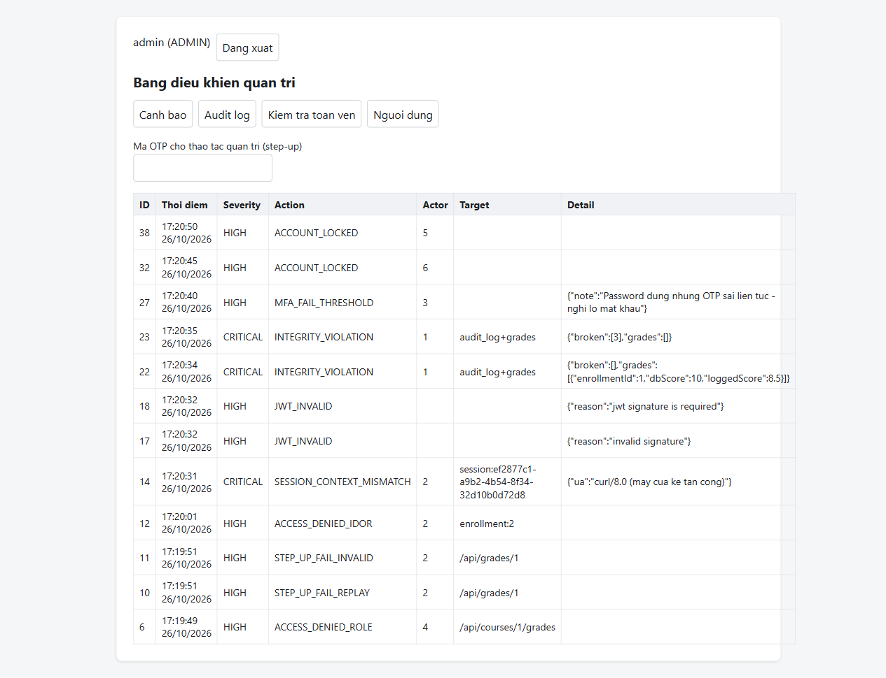

*Hình 5.7 — Trang admin: `SESSION_CONTEXT_MISMATCH` và `INTEGRITY_VIOLATION` Ở mức CRITICAL.*

| Action | Severity | Phát sinh khi | Phản ứng tự động |
| --- | --- | --- | --- |
| `LOGIN_PASSWORD_OK`, `LOGIN_SUCCESS`, `MFA_ENROLLED`, `GRADE_UPDATE`, `LOGOUT` | INFO | Hoạt động bình thường | — |
| `LOGIN_FAIL`, `LOGIN_FAIL_UNKNOWN_USER`, `MFA_FAIL_INVALID`, `MFA_FAIL_REPLAY`, `INPUT_REJECTED`, `RATE_LIMITED` | WARN | Sai thông tin, dữ liệu lạ, vượt ngưỡng tốc độ | Đếm để khoá |
| `ACCOUNT_LOCKED` | HIGH | Sai mật khẩu 5 lần | Khoá 15 phút |
| `MFA_FAIL_THRESHOLD` | HIGH | Mật khẩu đúng nhưng sai OTP 3 lần | Khoá + cảnh báo nghi lộ mật khẩu |
| `JWT_INVALID` | HIGH | Token sai chữ ký, sai `alg`, hết hạn, sai `iss`/`aud` | 401 |
| `ACCESS_DENIED_ROLE`, `ACCESS_DENIED_IDOR`, `STEP_UP_FAIL_*` | HIGH | Truy cập ngoài quyền, thiếu OTP khi sửa điểm | 403/401 |
| `ADMIN_REVOKE_SESSIONS`, `ADMIN_RESET_MFA`, `ADMIN_UNLOCK` | HIGH | Thao tác phản ứng sự cố | — |
| `SESSION_CONTEXT_MISMATCH` | CRITICAL | Token dùng từ ngữ cảnh khác | Thu hồi phiên |
| `SESSION_UNKNOWN` | CRITICAL | Chữ ký đúng nhưng `sid` không tồn tại | Cảnh báo nghi lộ `JWT_SECRET` |
| `INTEGRITY_VIOLATION` | CRITICAL | Chuỗi hash đứt hoặc điểm lệch log | Kích hoạt quy trình RECOVER |
| `ALERT_IDOR_BURST`, `ALERT_MASS_GRADE_CHANGE` | HIGH | Rule tương quan chạy mỗi 60 giây | Hiển thị trên dashboard admin |

### 5.9 Rule tương quan (`services/detect.js`)

| Rule | Điều kiện | Sự kiện sinh ra |
| --- | --- | --- |
| R1 | ≥ 5 `LOGIN_FAIL` cùng tài khoản trong 15 phút | `ACCOUNT_LOCKED` (xử lý ngay trong luồng login) |
| R2 | ≥ 3 `MFA_FAIL_*` sau `LOGIN_PASSWORD_OK` | `MFA_FAIL_THRESHOLD` (xử lý ngay trong luồng verify) |
| R3 | ≥ 3 `ACCESS_DENIED_IDOR` cùng người trong 5 phút | `ALERT_IDOR_BURST` |
| R4 | ≥ 15 `GRADE_UPDATE` cùng người trong 10 phút | `ALERT_MASS_GRADE_CHANGE` |
| R5 | Bất kỳ `SESSION_CONTEXT_MISMATCH`, `SESSION_UNKNOWN`, `INTEGRITY_VIOLATION` | Hiển thị ngay, không cần tương quan |

R3 và R4 chạy bằng `setInterval` 60 giây; trước khi ghi cảnh báo có kiểm tra trong cửa sổ
thời gian đã có cảnh báo cùng loại cho người đó chưa, để không ghi trùng.

### 5.10 Hardening tầng ứng dụng

| Cơ chế | Hiện thực | Kết quả đo |
| --- | --- | --- |
| Security headers | `helmet()` | `Content-Security-Policy: default-src 'self'; ... script-src 'self'; script-src-attr 'none'; object-src 'none'`, `X-Content-Type-Options: nosniff`, `X-Frame-Options: SAMEORIGIN`, **không có** `X-Powered-By` |
| Giới hạn body | `express.json({ limit: '10kb' })` | Body > 10 KB bị từ chối |
| Chỉ nhận JSON | Middleware trả 415 `JSON_ONLY` cho POST/PUT/PATCH/DELETE không phải `application/json` | Cùng với `SameSite=Strict` tạo thành lớp chống CSRF |
| Rate limit | 10 login / 300 API mỗi 15 phút / IP | TC08: request thứ 11 trả 429 |
| Không lộ stack trace | Error handler trả `{ error: 'INTERNAL_ERROR' }` | — |
| CSP tương thích UI | Toàn bộ JS nằm trong `public/js/*.js`, nạp bằng `<script type="module">`; không có `onclick=` hay script inline | DevTools Console không có lỗi vi phạm CSP |
| Chống XSS phía client | Hiển thị mọi dữ liệu từ server bằng `textContent`, không dùng `innerHTML` | — |

### 5.11 Giao diện (5 trang)

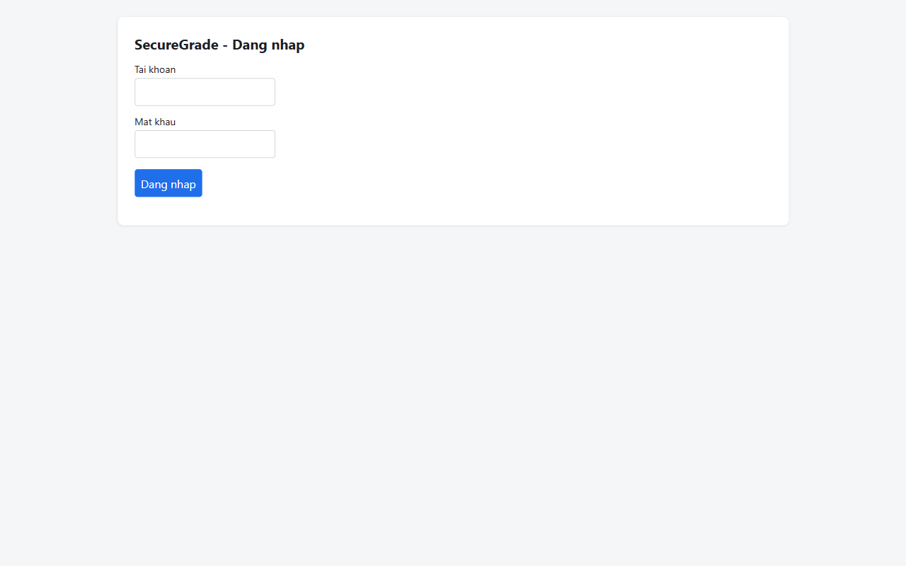

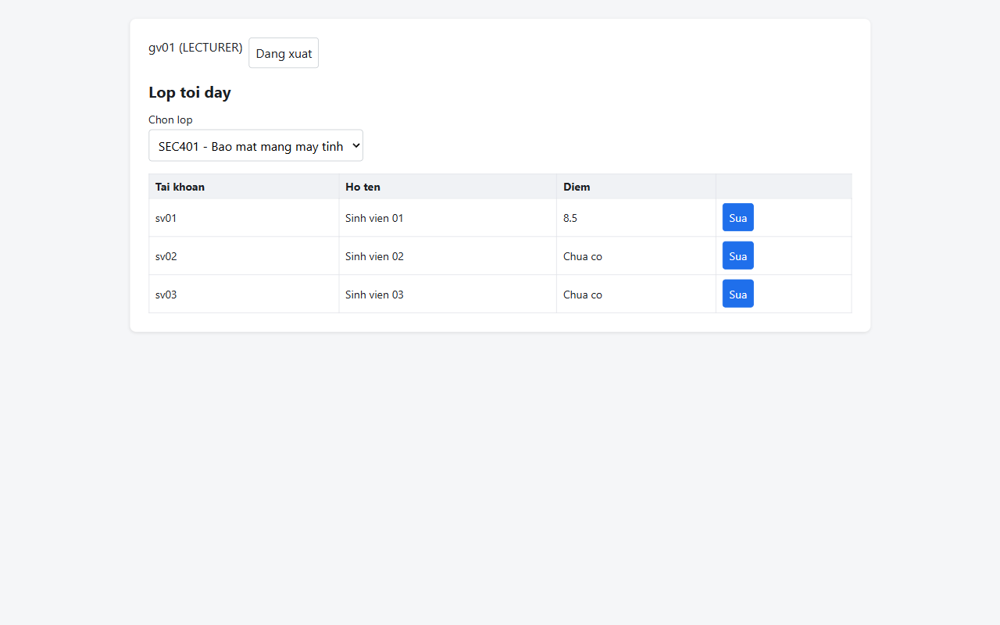

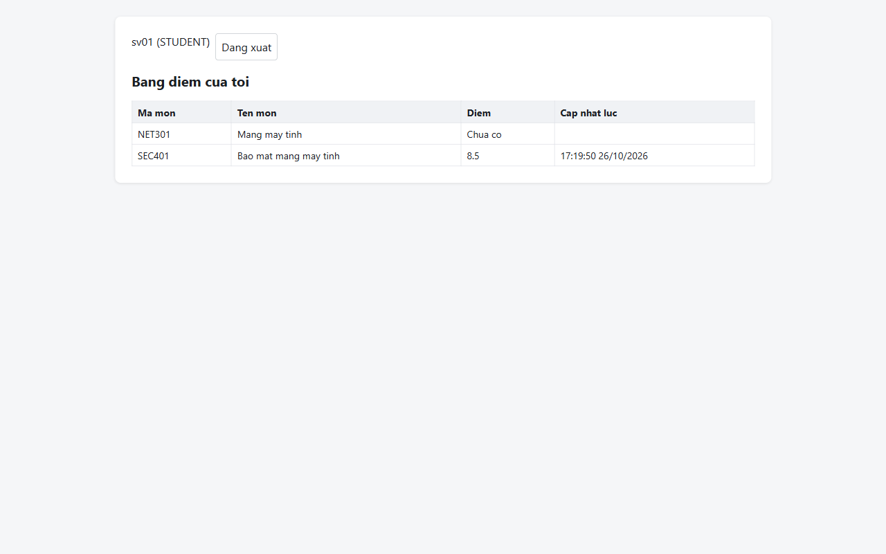

*Hình 5.8–5.10 — Trang đăng nhập, trang giảng viên, trang sinh viên (chỉ thấy điểm của chính mình).*

| File | Chức năng | API gọi |
| --- | --- | --- |
| `login.html` | Form username/password, chuyển sang `mfa.html` theo `next` | `/api/auth/login` |
| `mfa.html` | `MFA_ENROLL`: hiện QR + ô OTP; `MFA_VERIFY`: chỉ ô OTP | `/api/auth/mfa/*` |
| `student.html` | Bảng điểm của tôi | `/api/grades/me` |
| `lecturer.html` | Chọn lớp → bảng sinh viên → dialog sửa: điểm, lý do, OTP | `/api/courses/mine`, `/api/courses/:id/grades`, `PUT /api/grades/:id` |
| `admin.html` | 4 tab: Cảnh báo, Audit log, Kiểm tra toàn vẹn, Người dùng + 3 nút phản ứng sự cố | `/api/admin/*` |

Token **không** được lưu vào `localStorage`; chỉ nằm trong cookie HttpOnly. Việc chuyển
trang theo role chỉ là tiện lợi — quyền thật sự do server kiểm tra ở mỗi request.

### 5.12 API đầy đủ

| Method | Path | Vai trò | Kiểm soát bổ sung |
| --- | --- | --- | --- |
| POST | `/api/auth/login` | — | Rate limit 10/15 phút, lockout sau 5 lần sai |
| POST | `/api/auth/mfa/setup` | Pre-MFA, chưa bật MFA | 409 nếu đã bật |
| POST | `/api/auth/mfa/enable` | Pre-MFA | Xác minh OTP rồi mới bật |
| POST | `/api/auth/mfa/verify` | Pre-MFA, đã bật MFA | Lockout sau 3 OTP sai |
| POST | `/api/auth/logout` | Đã đăng nhập | Thu hồi session |
| GET | `/api/me` | Đã đăng nhập | — |
| GET | `/api/grades/me` | STUDENT | `student_id` lấy từ session |
| GET | `/api/courses/mine` | LECTURER | Chỉ lớp có `lecturer_id` = người gọi |
| GET | `/api/courses/:id/grades` | LECTURER, ADMIN | LECTURER phải là người dạy lớp đó |
| PUT | `/api/grades/:enrollmentId` | LECTURER | Ownership + validate + `X-OTP` + audit cùng transaction |
| GET | `/api/admin/alerts` | ADMIN | 100 sự kiện HIGH/CRITICAL mới nhất |
| GET | `/api/admin/audit?limit=` | ADMIN | Log gần nhất |
| GET | `/api/admin/integrity` | ADMIN | `chain: {total, broken, lastHash}`, `grades: [lệch]` |
| GET | `/api/admin/users` | ADMIN | Trạng thái MFA, khoá của từng user |
| POST | `/api/admin/users/:id/revoke-sessions` | ADMIN | + step-up OTP |
| POST | `/api/admin/users/:id/reset-mfa` | ADMIN | + step-up OTP, thu hồi mọi phiên |
| POST | `/api/admin/users/:id/unlock` | ADMIN | + step-up OTP |

---

## Chương 6. Kịch bản tấn công và kiểm thử

### 6.1 Sáu kịch bản tấn công

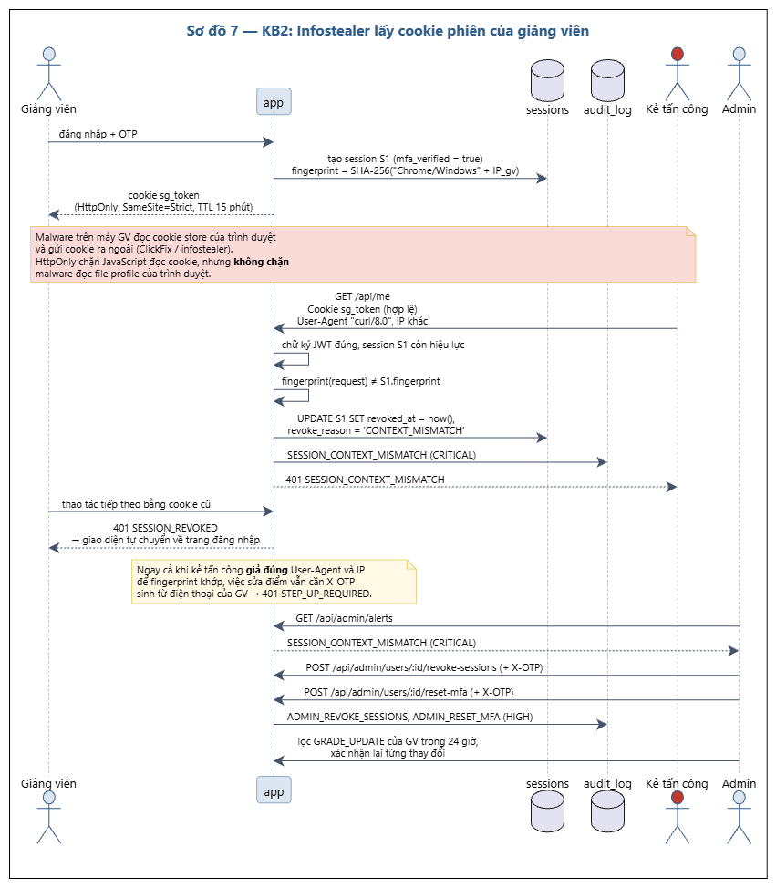

*Hình 6.1 — KB2: cookie hợp lệ dùng từ thiết bị khác bị fingerprint chặn.*

| KB | Kịch bản | Đầu vào bị giả mạo/đánh cắp | PREVENT | DETECT | RECOVER |
| --- | --- | --- | --- | --- | --- |
| KB1 | Phishing/ClickFix: GV nhập mật khẩu vào trang giả, kẻ tấn công đăng nhập | Mật khẩu thật | MFA TOTP, khoá sau 3 OTP sai | `MFA_FAIL_THRESHOLD`: mật khẩu đúng + OTP sai | Đổi mật khẩu, mở khoá |
| KB2 | ClickFix cài infostealer, lấy cookie phiên của GV đang đăng nhập | Cookie/JWT hợp lệ | Fingerprint phiên, step-up OTP, TTL 15 phút | `SESSION_CONTEXT_MISMATCH` (CRITICAL) | Thu hồi mọi phiên, reset MFA |
| KB3 | SV sửa JWT để thành ADMIN | Token bị chỉnh sửa, `alg=none` | Kiểm chữ ký, cố định HS256, role lấy từ DB | `JWT_INVALID` (HIGH) | — |
| KB4 | IDOR: đổi `enrollmentId`/`courseId` | Tham số URL | RBAC + ownership | `ACCESS_DENIED_*`, `ALERT_IDOR_BURST` | — |
| KB5 | SQLi/XSS qua ô nhập | Payload độc trong query/body | WAF CRS, validation, parameterized query, `textContent`, CSP | Log WAF, `INPUT_REJECTED` | — |
| KB6 | Insider sửa điểm trực tiếp, xoá log | Dữ liệu lưu trữ | `app_user` không UPDATE/DELETE trên `audit_log` | Hash-chain + đối chiếu điểm → `INTEGRITY_VIOLATION` | Khôi phục theo log hoặc backup |

### 6.2 Kết quả bộ test case: 25/25 PASS

Chạy tự động bằng `node tests/run-tests.mjs` trên DB sạch. Output đầy đủ:
[`docs/evidence/07-run-tests-output.txt`](evidence/07-run-tests-output.txt).

| ID | Loại | Mô tả | Kỳ vọng | Cơ chế | Kết quả |
| --- | --- | --- | --- | --- | --- |
| TC01 | Bình thường | `sv01` đăng nhập lần đầu, bật MFA | 200, `next=MFA_ENROLL`, có `MFA_ENROLLED` | bcrypt, TOTP | **PASS** |
| TC02 | Bình thường | `sv01` đăng nhập lần sau bằng OTP | 200, `LOGIN_SUCCESS` | TOTP | **PASS** |
| TC03 | Bình thường | SV xem điểm của mình | 200, đúng 2 môn của `sv01` | Ownership theo session | **PASS** |
| TC04 | Bình thường | GV nhập điểm 8.5 lớp mình kèm `X-OTP` | 200, `GRADE_UPDATE` có old/new, DB = `8.50` | RBAC, ownership, step-up, audit | **PASS** |
| TC05 | Bình thường | Admin kiểm tra toàn vẹn | 200, `broken=[]`, `grades=[]` (21 dòng log) | RBAC, hash-chain | **PASS** |
| TC06 | Bình thường | Dùng lại cookie sau khi đăng xuất | 401 `SESSION_REVOKED` | Session server-side | **PASS** |
| TC07 | Tấn công | Brute force `sv03`: sai 5 lần rồi đúng | Lần 5 ghi `ACCOUNT_LOCKED`, lần 6 trả 423 | Lockout | **PASS** |
| TC08 | Tấn công | 12 request login trong 15 phút | Request 11 trả 429, có `RATE_LIMITED` | Rate limit | **PASS** |
| TC09 | Tấn công (KB1) | Có mật khẩu `gv02`, OTP sai 3 lần | 423, `MFA_FAIL_THRESHOLD` (HIGH) | MFA, rule R2 | **PASS** |
| TC10 | Tấn công | Dùng lại OTP vừa dùng để sửa điểm | 401, `STEP_UP_FAIL_REPLAY` | `last_otp` 90 giây | **PASS** |
| TC11 | Tấn công (KB3) | Sửa payload JWT (`role=ADMIN`), giữ chữ ký cũ | 401 `INVALID_TOKEN`, `JWT_INVALID` | Chữ ký HS256 | **PASS** |
| TC12 | Tấn công (KB3) | JWT `alg=none` | 401, `JWT_INVALID` | `algorithms: ['HS256']` | **PASS** |
| TC13 | Tấn công | Dùng token pre-MFA gọi API nghiệp vụ | 401 `MFA_REQUIRED` | Middleware lớp 4 | **PASS** |
| TC14 | Tấn công (KB2) | Cookie `gv01` dùng ở User-Agent/thiết bị khác | 401 `SESSION_CONTEXT_MISMATCH`, CRITICAL | Fingerprint | **PASS** |
| TC14b | Tấn công (KB2) | Phiên gốc của GV sau khi phát hiện | 401 `SESSION_REVOKED` | Thu hồi tự động | **PASS** |
| TC15 | Tấn công (KB2) | Phiên hợp lệ nhưng không có `X-OTP` | 401 `STEP_UP_REQUIRED` | Step-up | **PASS** |
| TC16 | Tấn công (KB4) | `gv01` sửa điểm lớp NET301 kèm OTP đúng | 403, `ACCESS_DENIED_IDOR` | Ownership | **PASS** |
| TC17 | Tấn công (KB4) | `sv01` gọi `/api/courses/1/grades` | 403, `ACCESS_DENIED_ROLE` | RBAC | **PASS** |
| TC18 | Tấn công | `score = 15` | 400, `INPUT_REJECTED` | Validation + CHECK | **PASS** |
| TC19 | Tấn công (KB5) | SQLi trên query string | 403 từ WAF (rule 942100) | OWASP CRS | **PASS** |
| TC20 | Tấn công (KB5) | XSS `<script>` trong body JSON | 403 từ WAF (941100/941110) | OWASP CRS | **PASS** |
| TC21 | Tấn công | Kiểm tra ánh xạ port của Docker cho cả 3 service | Chỉ `waf` có `->` ra host; `app` và `db` không có (xem 4.3.1) | Segmentation | **PASS** |
| TC22 | Tấn công (KB6) | `postgres`: `UPDATE grades SET score = 10` | `/integrity` báo `dbScore=10 / loggedScore=8.5`, `INTEGRITY_VIOLATION` | Đối chiếu log | **PASS** |
| TC23 | Tấn công (KB6) | `app_user`: 4 lệnh phá hoại | `permission denied` cả 4; `SELECT` vẫn chạy | Least privilege | **PASS** |
| TC24 | Tấn công (KB6) | `postgres`: `UPDATE audit_log ... WHERE id = 3` | `broken` chứa đúng id 3 | Hash-chain | **PASS** |

Ghi chú về cách chạy test: bộ đếm rate limit nằm trong RAM của `app`, nên script tự
`docker compose restart app` trước mỗi nhóm test cần nhiều lần đăng nhập. OTP được lấy
bằng cách sinh mã cho cửa sổ hiện tại và cửa sổ kế tiếp (server chấp nhận lệch ±30 giây),
nhờ đó không phải chờ 30 giây giữa hai lần dùng OTP của cùng một người.

### 6.3 Công cụ tấn công

- `tests/attacks/forge-jwt.mjs` — sinh hai biến thể token từ một cookie thật: `TAMPERED`
  (sửa `role` thành `ADMIN`, giữ chữ ký cũ) và `ALG_NONE`.
- `tests/attacks/sqli-direct.mjs` — gửi payload SQLi **từ bên trong container `app`**, bỏ
  qua hoàn toàn WAF.

### 6.4 Chứng minh Defense-in-Depth: bỏ qua WAF vẫn an toàn

```
$ docker compose exec app node /tmp/sqli-direct.mjs
401 {"error":"INVALID_CREDENTIALS"} <= ' OR '1'='1' --
401 {"error":"INVALID_CREDENTIALS"} <= admin'--
401 {"error":"INVALID_CREDENTIALS"} <= x'; DROP TABLE grades; --

$ docker compose exec db psql -U postgres -d securegrade -tAc "SELECT count(*) FROM grades"
1
```

Cả ba payload đều trả về `401 INVALID_CREDENTIALS` — **không có lỗi SQL, không có thông
tin cấu trúc DB rò ra**, và bảng `grades` còn nguyên. Đây là bằng chứng rằng WAF là lớp
bổ sung chứ không phải lớp duy nhất.

### 6.5 Rule WAF đã khớp (ghi từ log thật)

| Payload | Rule ID khớp | Mô tả | Mã trả về |
| --- | --- | --- | --- |
| `?id=1' OR '1'='1` | 942100 + 949110 | SQL Injection Attack Detected via libinjection → Inbound Anomaly Score 5 | 403 |
| `<script>alert(document.cookie)</script>` | 941100, 941110, 941160, 941180 + 949110 | XSS via libinjection, Script Tag Vector, NoScript HTML Injection, Node-Validator Deny List | 403 |
| `User-Agent: sqlmap/1.8` | 913100 + 949110 | Found User-Agent associated with security scanner | 403 |
| `/../../etc/passwd` | — | **nginx tự trả 400** trước khi ModSecurity xử lý (URI không hợp lệ) | 400 |

Trường hợp path traversal cho thấy một điều đáng ghi nhận: request bị chặn, nhưng **không
phải bởi WAF** mà bởi chính nginx. Nếu chỉ dựa vào mã trả về 403 để kết luận "WAF đã chặn"
thì sẽ kết luận sai; phải đọc log để biết lớp nào thực sự chặn.

---

## Chương 7. Phân tích trade-off

### 7.1 Tám quyết định và cái giá phải trả

| ID | Quyết định | Được | Mất | Ngắn hạn | Dài hạn | Nhóm chọn |
| --- | --- | --- | --- | --- | --- | --- |
| T1 | MFA TOTP bắt buộc cho mọi vai trò | Chặn KB1 | Thêm thao tác mỗi lần đăng nhập; mất điện thoại phải nhờ admin reset | Tốn công hỗ trợ giai đoạn đầu | TOTP vẫn bị phishing thời gian thực (AiTM); nên nâng lên passkey/WebAuthn | **Bắt buộc** |
| T2 | Step-up OTP cho **mỗi** lần sửa điểm | Cookie bị đánh cắp không sửa được điểm | OTP đổi mỗi 30 giây và không dùng lại được → tối đa ~1 lần sửa/30 giây mỗi giảng viên | Chấp nhận cho prototype; nhập điểm cả lớp sẽ rất chậm | Chuyển sang "sudo mode" 5 phút, hoặc nhập theo lô với 1 OTP cho cả lô | **Prototype: mỗi request** |
| T3 | JWT 15 phút + kiểm session trong DB mỗi request | Thu hồi phiên tức thì | Mất tính stateless, thêm 1 truy vấn/request | Không đáng kể ở quy mô lớp học | Cần cache (Redis) khi tải lớn | **Giữ** |
| T4 | Fingerprint User-Agent + IP | Phát hiện token bị đánh cắp (TC14) | False positive khi đổi Wi-Fi/4G hoặc cập nhật trình duyệt | Ít ảnh hưởng vì phiên chỉ 15 phút | Phiên gắn thiết bị bằng khoá mật mã, hoặc đánh giá rủi ro theo ngữ cảnh | **Giữ, ghi nhận false positive** |
| T5 | WAF Paranoia Level 1 thay vì 2 | Ít false positive (số liệu 7.2) | Bỏ lọt một số biến thể tấn công | Dùng số liệu đo được | Viết rule exclusion cho `reason` rồi nâng lên PL2 | **PL1** |
| T6 | Audit hash-chain tự làm thay vì SIEM | Miễn phí, đủ chứng minh | Không tương quan đa nguồn; superuser vẫn tính lại được chuỗi | Đủ cho đồ án | SIEM (Wazuh) + lưu trữ WORM, chi phí vận hành cao | **Hash-chain + anchor ngoài** |
| T7 | Backup hằng ngày thay vì PITR | Đơn giản | RPO 24 giờ | Đủ | PITR/WAL archiving khi dữ liệu lớn | **Hằng ngày** |
| T8 | HTTP trong lab | Demo nhanh, không cần chứng chỉ | Cookie và OTP có thể bị nghe lén trên mạng | Chỉ chạy `localhost` | Bắt buộc HTTPS + HSTS + cookie `secure` | **HTTP lab, nêu rõ hạn chế** |

### 7.2 Số liệu đo: Paranoia Level 1 vs 2 (cho T5)

Phương pháp: gửi 15 request **hợp lệ** (`tests/paranoia-check.mjs`) gồm các trường hợp dễ
bị chặn oan — mật khẩu có `@`, `#`, `$`, `%`, `&`, `*`, `!`; lý do sửa điểm bằng tiếng Việt
có dấu, có dấu nháy đơn, dấu `;`, dấu ngoặc, dấu `--`. Mỗi mã 403 là một false positive.
Sau đó gửi lại 3 payload tấn công để xác nhận cả hai mức đều chặn được.

| Paranoia Level | Request hợp lệ bị chặn (false positive) | Payload tấn công bị chặn | Trường hợp bị chặn oan |
| --- | --- | --- | --- |
| **PL1** | **0 / 15** | SQLi 403, scanner UA 403 | — |
| **PL2** | **1 / 15** | SQLi 403, scanner UA 403 | `reason = "Thieu bai -- da nop bu"` → 403 (dấu `--` bị coi là SQL comment) |

Kết luận: ở mức PL2, một lý do sửa điểm viết hoàn toàn bình thường ("Thiếu bài -- đã nộp
bù") bị chặn. Trong nghiệp vụ nhập điểm, giảng viên gõ tự do vào trường `reason`, nên
loại false positive này sẽ xảy ra thật và xảy ra thường xuyên. Vì PL2 không chặn thêm được
payload tấn công nào trong bộ đo của nhóm, **nhóm chọn PL1** và ghi nhận hướng dài hạn:
viết rule exclusion riêng cho trường `reason` rồi mới nâng lên PL2.

### 7.3 Số liệu đo: diễn tập phục hồi (cho T7)

Quy trình diễn tập:

1. Nhập điểm hợp lệ qua app → `sh scripts/backup.sh` (dump bằng `pg_dump -Fc`).
2. Giả lập thảm hoạ: `DELETE FROM grades` bằng user `postgres`.
3. Bấm giờ, chạy `sh scripts/restore.sh backups/sg_20261026_165051.dump`.
4. Chờ `/health` trả 200, kiểm tra lại dữ liệu và `/api/admin/integrity`.

| Chỉ số | Giá trị đo được |
| --- | --- |
| **RTO** (từ lúc bắt đầu restore đến lúc hệ thống phục vụ lại được) | **5–6 giây** (đo 2 lần: 6 giây và 5 giây) |
| **RPO** (thiết kế: backup hằng ngày) | tối đa 24 giờ |
| Dữ liệu sau restore | Đúng (số dòng `grades` trở lại như trước khi xoá) |
| Kiểm tra toàn vẹn sau restore | `broken = []`, `grades = []` |

RTO 5–6 giây là con số của môi trường lab với dữ liệu rất nhỏ; nó chứng minh **quy trình
restore chạy được và đã được diễn tập**, chứ không phải một con số dùng để cam kết SLA.

### 7.4 Trade-off tổng: an toàn đổi bằng tiện lợi — đo ở đâu

Ba con số trên cho thấy cùng một mô thức: mỗi lớp an toàn thêm vào đều có một chi phí
**đo được**, và quyết định đúng chỉ xuất hiện sau khi đo.

- T2 (step-up mỗi request): chi phí là ~30 giây cho mỗi lần sửa điểm.
- T5 (PL2): chi phí là 1/15 request hợp lệ bị chặn oan, lợi ích thêm là 0 trong bộ đo.
- T7 (backup hằng ngày): chi phí là RPO 24 giờ, lợi ích là quy trình restore 5–6 giây.

---

## Chương 8. Kết luận

### 8.1 Kết quả

SecureGrade đã hiện thực và **kiểm thử tự động** một hệ thống nhập điểm với 12 lớp kiểm
chứng độc lập trên mỗi request sửa điểm. Kết quả chính:

1. **Mật khẩu bị đánh cắp là không đủ.** Kẻ tấn công có mật khẩu giảng viên vẫn bị chặn ở
   MFA, và việc đó để lại một cảnh báo HIGH có ý nghĩa điều tra rõ ràng: *"mật khẩu đúng
   nhưng OTP sai liên tục — nghi lộ mật khẩu"* (TC09).
2. **Cookie phiên bị đánh cắp là không đủ.** Fingerprint phát hiện và thu hồi phiên ngay
   (TC14); kể cả khi fingerprint bị giả đúng, việc sửa điểm vẫn cần một OTP mới từ điện
   thoại giảng viên (TC15).
3. **Không tin cả cơ sở dữ liệu của chính mình.** Hash-chain và phép đối chiếu điểm với log
   phát hiện được cả insider có quyền `postgres` (TC22, TC24), còn `app_user` thì không có
   quyền xoá dấu vết (TC23).
4. **Defense-in-Depth là thật, không phải khẩu hiệu.** Bỏ qua hoàn toàn WAF, payload SQLi
   vẫn bị parameterized query và quyền DB tối thiểu chặn (mục 6.4).
5. **25/25 test case PASS**, với 2 số liệu trade-off đo thật (PL1/PL2, RTO).

### 8.2 Hạn chế

| Hạn chế | Ảnh hưởng | Vì sao chấp nhận trong phạm vi đồ án |
| --- | --- | --- |
| HTTP, không HTTPS | Cookie và OTP có thể bị nghe lén | Chỉ chạy `localhost`; thêm HTTPS là việc cấu hình, không đổi thiết kế |
| `mfa_secret` lưu dạng rõ | Ai đọc được DB sẽ sinh được OTP | Đã thiết kế phương án AES-256-GCM (`MFA_ENC_KEY`) nhưng chưa bật, vì cắt phạm vi theo thứ tự ưu tiên; nếu bật thì script test không đọc được secret từ DB để tự động hoá |
| Superuser DB vẫn tính lại được hash-chain | Insider kiên nhẫn có thể xoá dấu vết hoàn toàn | Giảm thiểu bằng anchor `lastHash` lưu ngoài hệ thống; giải pháp đúng là WORM storage/SIEM |
| `req.ip` có thể luôn là IP của container WAF | Fingerprint chỉ còn phụ thuộc User-Agent; rate limit tính chung cho mọi client | Cần kiểm tra WAF có gửi `X-Forwarded-For` hay không trên môi trường triển khai thật |
| Rate limit lưu trong RAM | Mất bộ đếm khi restart app | Dùng store Redis khi có nhiều instance |
| Bộ đo PL1/PL2 chỉ 15 request | Kết luận T5 chỉ đúng với tập đo này | Mở rộng bằng CRS test suite khi có thời gian |
| TOTP không chống phishing thời gian thực (AiTM) | Trang giả có thể chuyển tiếp cả OTP ngay lúc đó | Giải pháp đúng là passkey/WebAuthn (gắn với origin) |

### 8.3 Hướng phát triển

1. **Passkey/WebAuthn** thay TOTP — chống được cả phishing thời gian thực vì credential
   gắn với origin của trang.
2. **HTTPS + HSTS + cookie `secure`** và quản lý secret bằng Vault.
3. **"Sudo mode" 5 phút** thay vì step-up từng request — giữ được bảo vệ của T2 nhưng
   bỏ được giới hạn 1 lần sửa/30 giây.
4. **Đẩy audit log sang SIEM / WORM storage** để superuser DB không thể tính lại chuỗi.
5. **PITR (WAL archiving)** để giảm RPO từ 24 giờ xuống phút.
6. **Rule exclusion cho trường `reason`** rồi nâng WAF lên PL2.

---

## Phụ lục

### A. Hướng dẫn cài đặt và chạy

Xem [`README.md`](../README.md) ở gốc repo. Tóm tắt:

```bash
cp .env.example .env     # rồi thay 3 giá trị, sinh secret bằng:
node -e "console.log(require('crypto').randomBytes(48).toString('hex'))"
docker compose up -d --build
# mở http://localhost:8080
```

### B. Tài khoản demo

| Username | Mật khẩu | Vai trò |
| --- | --- | --- |
| `admin` | `Admin@2026demo` | ADMIN |
| `gv01` | `Gv01@2026demo` | LECTURER (lớp SEC401) |
| `gv02` | `Gv02@2026demo` | LECTURER (lớp NET301) |
| `sv01`–`sv03` | `Sv01@2026demo` … | STUDENT |

Các mật khẩu này **chỉ dùng cho demo** và được ghi công khai trong báo cáo.

### C. Output `run-tests.mjs`

Xem [`docs/evidence/07-run-tests-output.txt`](evidence/07-run-tests-output.txt).

### D. Danh sách sơ đồ

Tám sơ đồ được **nhóm vẽ bằng draw.io**. Mỗi sơ đồ có một file đặc tả `.puml`
trong `docs/diagrams/` ghi đầy đủ thành phần, nhãn và quan hệ — dùng làm bản thiết kế
để vẽ, đồng thời là bản ghi dạng văn bản của sơ đồ để dễ soát và sửa về sau.
Mỗi file tự chứa, không dùng `!include`, nên dán thẳng vào công cụ dựng sơ đồ là hiển
được; bảng màu quy ước lặp ở đầu cả tám file dưới dạng ghi chú.

| # | Sơ đồ | Loại | File đặc tả | Mục dùng |
| --- | --- | --- | --- | --- |
| 1 | Kiến trúc phân vùng + Allowed Flows | Deployment | `01-kien-truc-phan-vung.puml` | 4.1 |
| 2 | DFD mức 1 có trust boundary | DFD | `02-dfd-muc-1.puml` | 4.5 |
| 3 | Use case + misuse case | Use case | `03-usecase-misusecase.puml` | 3.2 |
| 4 | Đăng nhập + MFA | Sequence | `04-sequence-dang-nhap-mfa.puml` | 5.3 |
| 5 | Sửa điểm có step-up + audit | Sequence | `05-sequence-sua-diem.puml` | 5.5 |
| 6 | Pipeline 12 lớp kiểm chứng | Activity | `06-activity-pipeline.puml` | 4.6 (hình cả trang) |
| 7 | KB2: token bị đánh cắp | Sequence | `07-sequence-kb2-token-bi-danh-cap.puml` | 6.1 |
| 8 | ERD 6 bảng | ERD | `08-erd.puml` | 5.2 |

Sơ đồ 6 có 12 nhánh nối tiếp nên rất cao; khi vẽ nên chia 3 cột (lớp 1–4, 5–8,
9–12) nối bằng connector tròn, để vừa một trang A4.

### E. Runbook theo sự cố

| Sự cố | Dấu hiệu | Xử lý theo thứ tự |
| --- | --- | --- |
| Nghi lộ mật khẩu (KB1) | `MFA_FAIL_THRESHOLD` | 1. Liên hệ GV xác nhận qua kênh khác. 2. Đổi mật khẩu qua luồng F4. 3. `unlock`. 4. Kiểm tra GV có dùng chung mật khẩu ở hệ thống khác. |
| Nghi đánh cắp phiên (KB2) | `SESSION_CONTEXT_MISMATCH` | 1. `revoke-sessions`. 2. `reset-mfa` nếu nghi máy nhiễm mã độc. 3. Yêu cầu GV quét mã độc, đổi mật khẩu từ máy sạch. 4. Lọc `GRADE_UPDATE` của GV trong 24 giờ, xác nhận từng thay đổi. |
| Điểm bị sửa ngoài app (KB6) | `INTEGRITY_VIOLATION` (grades) | 1. Chụp kết quả integrity làm bằng chứng. 2. GV chủ lớp nhập lại `loggedScore` qua app với lý do "Khôi phục sau sự cố toàn vẹn". 3. Đổi `POSTGRES_PASSWORD`, rà soát ai có quyền trên host. |
| Log bị sửa (KB6) | `INTEGRITY_VIOLATION` (chain) | 1. So `lastHash` với anchor lưu ngoài. 2. Restore từ backup gần nhất trước thời điểm hỏng. 3. Đối chiếu thay đổi sau backup với GV. |
| Nghi lộ `JWT_SECRET` | `SESSION_UNKNOWN` | 1. Sinh secret mới trong `.env`. 2. `docker compose up -d app` → mọi token cũ mất hiệu lực ngay. 3. Thu hồi toàn bộ session trong DB. |

### F. Nguồn tham khảo

1. OWASP Core Rule Set v4 — `owasp/modsecurity-crs:nginx`, biến `BACKEND`, `PORT`,
   `BLOCKING_PARANOIA`, `MODSEC_RULE_ENGINE`.
   https://github.com/coreruleset/coreruleset
2. RFC 6238 — TOTP: Time-Based One-Time Password Algorithm.
3. RFC 7519 — JSON Web Token (JWT).
4. OWASP Top 10 (2021). https://owasp.org/Top10/
5. OWASP Cheat Sheet Series — Authentication, Session Management, Logging.
6. PostgreSQL 16 Documentation — GRANT, Advisory Locks.
7. `otplib` v13 API Reference (`generateSecret`, `generateURI`, `verify`, `epochTolerance`).
